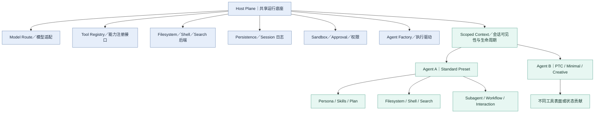

# Task03｜Agent 能力组合：Preset、Scope、Host Plane 与 Agent Plane

> Datawhale《DeepSeek Harness 技术入门》 · 鲸构万象小队  
> 学习日期：2026-10-21  
> 学习范围：用户提供的 Task03 官方目标及所读教材章节（已由学习者确认阅读完成）  
> **完成状态**：概念笔记、分层图、两组案例和自测答案已整理；**尚未获得 Task02 四个 Session 的真实运行日志，本篇不宣称已完成新的实机对照或 Datawhale 平台打卡。**

## 1. 学习目标与一句话结论

本 Task 需掌握：

1. 四套 Preset 不是四个独立 Agent，而是**同一 Runtime 上的四种能力组合**；
2. 区分 Preset、Scope、Host Plane、Agent Plane；
3. 理解 Scope Context 为何同时关联**可见性**与**注册所有权／生命周期**；
4. 将 Standard 的能力基线分为**面向模型的工具、会话级状态、Host 能力适配项**；
5. 解释 PTC 的 Tool Presentation（`mode: code`）以及 Minimal 的固定 Prompt、持久 Bash 与 `str_replace_editor`；
6. 回答官方三个自测问题，并能用自己的实例分辨 Agent Plane 与 Host Plane 的修改。

一句话总结：**Host 复用基础设施，Agent Scope 装配本次会话的能力；Preset 改变组合，而不是复制整套系统。**

## 2. 四个核心概念

| 概念 | 定义与职责 | 不能误解成 |
| --- | --- | --- |
| **Preset** | 一个 Agent 使用的工具、指令及状态贡献的配置方案 | 四个不同的大模型、四个独立 Runtime |
| **Scope** | 为某项注册提供身份、可见性、继承和撤销边界；它是跨层运行的机制 | 安全沙箱、独立容器或另一套 Runtime |
| **Host Plane** | 共享的模型路由、注册表、文件与 Shell 提供方、持久化、权限等宿主能力 | 所有工具都必须对全部会话开放 |
| **Agent Plane** | 面向单个 Agent / 会话装配的工具表面、Persona、Plan 等会话级贡献 | 每个 Session 复制一份 Host 插件树 |

### 2.1 Scope Context 为什么重要？

官方 `dsh-scope` 的基本设计是：通过带作用域的上下文注册工具、监听器等能力，同时确定**谁能看到**与**资源由谁拥有**。作用域释放时，属于它的注册项一并撤销。

具体机制：

- **全局贡献 + Scope 覆盖层**：会话读取时看到适用的共享项与专属项；
- **父子继承**：子作用域可看到祖先的贡献；近处的同名定义可以遮蔽远处定义；
- **资源回收**：`dispose()` 完成后，该作用域自己注册的能力不再有效；
- **隔离的前提**：注册表或事件分发必须**具备 Scope 感知能力**。随意调用全局服务，不能因拿着 `agent.ctx` 就自动隔离；
- **不是权限边界**：Scope 只控制受信任同进程插件的注册可见性和所有权，沙箱与文件权限需要其他机制。

对应官方资料：

- [Scope 子系统](https://github.com/deepseek-ai/deepseek-harness/blob/master/docs/subsystems/scope.zh.md)
- [dsh-scope 包说明](https://github.com/deepseek-ai/deepseek-harness/blob/master/packages/core/scope/README.zh.md)
- [Cordis 入门](https://github.com/deepseek-ai/deepseek-harness/blob/master/docs/cordis-primer.zh.md)

## 3. Host Plane / Agent Plane 概念分层图

> **教学概念图，不是官方源码中每个包的完整映射。** 图中注册表和工具可同时跨越两层，不能把 UI、工具和状态的来源机械地都归入单一层。



关键不是“Host 有一套工具、Agent 再复制一套工具”，而是 **Host 能力通过合适的 scoped registry／适配接口，供某个 Agent 选择性使用**。

### 3.1 为什么要分层？

避免两个极端：

1. **全部放 Host 全局**：某个会话增加工具或改变提示词时，其他会话可能被污染，独立实验困难；
2. **每个 Agent 完全复制底层**：模型、持久化、权限和基础设施重复创建，增加配置和资源成本，也会导致更新、维护困难。

分层使得共享与隔离各归其位。注意，现实系统仍可能根据提供方与架构变化保留部分会话级资源，不应理解为 Host 永远只有一个全局实例。

## 4. Standard 的九项能力基线：按作用域及贡献类型分析

下表根据**本期教材给出的九类组合项**整理为工程学习模型，不是逐行核实当前 DSH 代码的插件清单。许多能力是“**Agent-facing 工具 + Host 提供方**”的组合，不能说全部仅存在 Agent Plane。

| 能力 | 会话 / Agent Plane 的贡献 | Host Plane 的共享提供方 | 组合项分类（主要） |
| --- | --- | --- | --- |
| **Persona** | 给当前 Agent 注入的角色／系统指令片段 | 提示词装配机制 | 会话级指令与状态 |
| **Filesystem** | 当前 Agent 可见的文件读写工具与规则 | 文件系统提供方、路径与权限控制 | 模型工具 + Host 适配 |
| **Shell** | 当前 Agent 可见的命令工具 | Shell／进程后端与执行策略 | 模型工具 + Host 适配 |
| **Search** | 搜索工具入口及可用能力 | 检索后端、本地或外部搜索适配 | 模型工具 + Host 适配 |
| **Skills** | 可见的 Skills 与按需调用或注入的指令 | Skill 发现、载入、注册机制 | 会话指令 + 模型能力入口 |
| **Plan** | 该 Agent 当前任务的计划及相关工具 | 计划持久化、会话／状态机制 | 会话级状态，可能带工具 |
| **Subagent** | 委派子任务的模型可见接口 | 创建／管理子 Agent 的运行能力 | 模型工具 + Host 适配 |
| **Workflow** | 工作流的调用入口或策略 | Workflow 注册与执行机制 | 模型工具 + Host 适配 |
| **Interaction** | 向用户提出问题、请求确认等入口 | UI、交互服务与审批机制 | 模型工具 + Host 适配 |

要能回答三问：

- **属于哪个作用域？** Agent 看到的“能力贡献”是否应该限定当前会话？共享的实际执行服务是否位于 Host？
- **由谁提供？** 具体 Plugin / Service Provider 是什么？
- **向谁开放？** 当前 Agent、全部 Agent，还是用户 UI / 外部客户端？权限又由谁决定？

这里“模型可见”不等于“已授权执行”。工具是否能执行，还受到宿主权限、审批和沙箱约束。

## 5. PTC：同一批能力，不同呈现方式

### Standard vs PTC

按本期教材：

- **Standard**：模型通常看见原生工具定义，逐次请求调用工具；
- **PTC**：通过 Tool Presentation（`mode: code`）将可用工具以**程序化接口**呈现，模型可生成代码，在代码内编排多次工具调用。

因此，“差异小”指的是**核心能力来源与主要组合可以相同**，但“工具如何展示、调用怎样编排”的关键配置变化，会显著改变执行形态；不是把同一组工具替换为更强的模型。

#### Round trip 压缩

假设原本需要三次工具操作：

```text
Standard（示意）
模型决策 → 工具1 → 模型决策 → 工具2 → 模型决策 → 工具3 → 总结

PTC（示意）
模型生成调用代码 → 代码组织工具1／2／3 → 返回结果 → 总结
```

**为什么 PTC 不一定更快？**

- 要先生成足够正确的代码；
- 代码需要执行环境、异常处理与必要的检查；
- 工具本身也有运行耗时；
- 动态依赖较强的任务仍可能需要多次模型判断；
- 简单任务用程序化接口反而可能增加固定开销。

因此 PTC **可能减少模型与工具之间的往返**，但不能推出所有任务的总延迟必然下降。

## 6. Minimal：把 Harness 压薄

按本期任务要求，Minimal 的主要特征是：

- **固定 Prompt**；
- **持久 Bash**；
- **`str_replace_editor`**；
- 不提供 Standard 的完整复合能力表面。

这样做有利于在相对固定、精简的工具环境中比较表现，减少其他复杂插件与工具策略对实验结果的影响。

但它不是“没有 Harness”，也不是“没有安全问题”：基础工具仍依赖运行环境，仍要管理文件、进程、权限及任务反馈。**Benchmark 的结果只适用于该评测设置，不能直接外推成完整 Standard 或 Desktop 产品的任务成功率。**

额外区分：当代官方仓库里还出现名为 `sdk-minimal` 的 **Profile / Bundle**。它与教材讨论的 **Minimal Agent Preset** 在概念层次上不同，不应仅因为名字相似而直接等同。参见[官方架构文档](https://github.com/deepseek-ai/deepseek-harness/blob/master/docs/architecture.zh.md)。

## 7. 两组“改 Agent Plane”与“改 Host Plane”的实例

### 场景 A：某个研究 Agent 禁用写文件

**需求**：文旅研究 Agent 只读资料、列出信息缺口；另一个设计 Agent 仍可以输出文件。

**归属**：优先在该 Agent 的能力组合中不暴露写文件工具或限制其工具表面，属于 **Agent Plane 的差异化配置**。

**安全提醒**：如果要求真正的只读安全保证，仍须由 Host 的沙箱／权限策略约束，不能仅隐藏一个工具或在 Prompt 中写“禁止写入”。

### 场景 B：所有 Agent 的文件操作都进远程容器

**需求**：工作台中的研究 Agent、设计 Agent、编程 Agent 都不得在本机直接执行文件操作，而要经过统一隔离的远程执行环境。

**归属**：更换 **Host Plane 的文件系统与进程执行提供方**（及权限／沙箱配置），让共用的文件读写／Shell 操作走受控容器。无需为每个 Preset 单独改写工具实现。

**核心区分**：某个 Agent **能看到／可使用什么能力**，偏向 Agent Plane；底层操作 **实际在哪儿完成、由哪套服务保障**，偏向 Host Plane。

## 8. 官方三道自测题参考答案

**Q1：DSH 的分层避免哪两种极端？各自代价是什么？**

A：避免“所有能力都注册在 Host 全局导致会话间串扰”与“每个 Agent 复制一整套基础设施导致资源、依赖及维护成本上升”。Host 共享基础服务，Agent Scope 对会话级贡献进行隔离和生命周期管理。

**Q2：「会话 A 新增的 Tool 影响到会话 B」问题出在哪一层？**

A：先检查工具注册的 **Scope／作用域边界**。本应限定 A 的贡献被注册到全局层、或者消费方没有按 Scope 过滤，可能导致 B 也看到它。不能仅凭现象判断是“模型太聪明”或“B 的提示词错误”。还应注意某些 Host 服务本来就是共享的，需先检查设计是否要求隔离。

**Q3：PTC 与 Standard 在源码层面的差异有多小？改变了什么？**

A：按本次教材，PTC 的核心变化集中在 **Tool Presentation 的 `mode: code`** 等相关组合配置；其工具能力来源并不需要全部重建。小的配置差异改变了工具对模型的呈现和多步调用的组织方式。具体到当前 DSH 版本的源代码差异，仍应以对应 commit 和插件组合树为准，不能只凭教材概念声称“只有一行改动”。

## 9. 个人理解与课程反思

我已有 DSH 桌面端、模型配置和 ACP 相关使用经历，但此前的注意力更多是“能否接入、能否运行”。本章帮助我认识到：

- **共享能力和会话级定制必须分开设计**。把所有工具全局注册虽然省事，但会造成不同 Agent 之间能力污染的风险。
- **Scope 是注册所有权与可见性机制，而不是权限系统**。会话级禁用写入工具，仍然不能代替 Host 层的沙箱与审批。
- **Preset 的变化不必带来另一个 Runtime**。在同一运行系统中，通过组合与工具呈现策略就能支持不同的使用方式。
- **性能比较要看完整执行链**。PTC 可能减少轮次往返，但是否更快必须通过同条件测试，而不是从“Code Mode”名字推断。

这些思路可以用来理解 Personal AI Worktable 的多 Agent 运行方式，但本次是学习与分析，**没有修改正式工作台的架构或配置**。

## 10. 与 Task02 实机对照的关系

Task03 提醒对照 Task02 的四个 Session 理解。当前 GitHub Task02 笔记仅有**实验设计与待测记录表**，未包含可核实的四组真实执行结果。本次因此只做理论分层、案例与自测；待有完整日志后，再新增逐项对照，不虚构执行时长、工具调用或模型输出。

## 11. Task03 打卡摘要

**本次学到**：四套 Preset 共享 Runtime，不是四个独立 Agent；Host Plane 提供模型路由、注册表、持久化、文件与进程等基础能力，Agent Plane 通过 Scope Context 装配会话级的工具和状态。Scope 既影响贡献的可见性，也影响注册生命周期；它不是沙箱。Standard 的九类组合项可从模型工具、会话级状态和 Host 适配三方面理解。PTC 的关键是改变工具呈现（`mode: code`）和编排方式，而 Minimal 通过固定 Prompt、持久 Bash 与 `str_replace_editor` 提供更薄的评测环境。

**个人收获**：学会区分“给某个 Agent 调整可见工具”与“为所有 Agent 替换底层执行服务”两类修改；以后设计或评估 Agent 系统时，将同时检查作用域隔离、共享服务、权限边界和任务验证。

**完成形式**：已阅读课程对应教材页码，整理结构图、Standard 九项能力分析、两组实例和官方自测答案。**未将尚未执行的对照实验写作已完成。**

## 12. 参考资料

1. [Datawhale 课程页](https://www.datawhale.cn/learn/summary/381)
2. [DeepSeek Harness 官方仓库](https://github.com/deepseek-ai/deepseek-harness)
3. [官方架构：Profile、Bundle、能力 seam](https://github.com/deepseek-ai/deepseek-harness/blob/master/docs/architecture.zh.md)
4. [官方 Scope 子系统](https://github.com/deepseek-ai/deepseek-harness/blob/master/docs/subsystems/scope.zh.md)
5. [官方 dsh-scope 包文档](https://github.com/deepseek-ai/deepseek-harness/blob/master/packages/core/scope/README.zh.md)
6. [官方 Cordis 入门](https://github.com/deepseek-ai/deepseek-harness/blob/master/docs/cordis-primer.zh.md)

> **资料与版本边界**：本笔记以学习者提供的 Task03 教学目标与参考作业为主线，并用上述官方文档补充核对。教材所描述的 Standard / PTC / Minimal 组合方式与最新仓库实现可能出现版本差异，特别是 Preset 命名和插件树结构，需在实际版本中验证。
