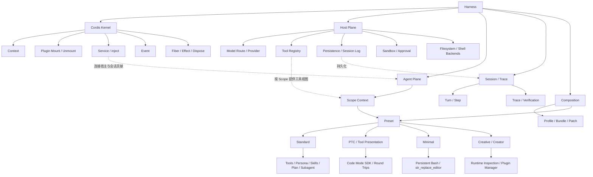

# Task04 - Creative 模式、Cordis Kernel 与“一切皆插件”综合复盘

> Datawhale《DeepSeek Harness 技术入门》 | 学习小队：鲸构万象  
> 学习日期：2026-10-22  
> 学习范围：第3章后半（Creative、Cordis Kernel、3.9 小结）与 Task01–04 知识整合  
> **状态**：用户已确认读完本次对应教材页码；本笔记完成概念地图、约 610 汉字短文、四道自测及打卡摘要。**未进行本轮 Creative 实机实验**，Task02 的四组 Session 日志仍未提供；尚未代替用户在 Datawhale 打卡平台提交。

## 1. 核心结论

**模型提供推理，Harness 组织任务执行，Cordis Kernel 提供插件组合的基本运行语义。**

四套 Preset 不是四个独立的 Runtime；它们按各自的能力组合选择模型可见工具、Persona、提示词、上下文相关能力与部分运行时扩展能力。Host Plane 共享进程级服务，Agent Plane 借助 Scope 挂载会话级贡献。

## 2. Creative 的“创造”究竟指什么？

课程强调一个值得记住的**递归式设计**：

> Agent 不只能操作外部文件，还能够在授权范围内观察、试验、扩展承载自己运行的 Harness。

这意味着 Runtime composition 也成为可研究、可配置的对象。但是**可观察、可试验、可持久修改是不同权限等级的操作**，不能混同。

### 2.1 特别注意：旧教材中的 `cordis_mount` 与当前代码存在版本差异

| 层面 | 早期设计 / 教材讨论的机制 | 2026-10-22 核验的官方 `master` |
| --- | --- | --- |
| 观察运行时 | `cordis_inspect` | `cordis_inspect_list`、`cordis_inspect_query`（只读） |
| 临时挂载代码 | `cordis_mount`，执行模型生成的代码并挂载临时插件 | 当前 `tool-cordis` 源文件**未注册**该工具 |
| 卸载临时插件 | `cordis_unmount`，释放临时 Fiber | 当前检查工具不提供此操作 |
| 持久配置更改 | 临时插件不等于持久修改 | 通过 **Plugin Manager** 安装 / 管理可持久配置的插件 Bundle |

早期实现文档说明：`cordis_mount` 接收模型生成的代码（当时运行时以异步 JavaScript 函数体求值），把返回的 Plugin 挂载到内部动态组并分配临时 id；卸载会等待插件资源清理。此类实验**不会自动写入普通项目文件、也不会在重启后恢复**。

当前官方源码和工具目录明确：Creator 提供两个只读检查工具，持久变更通过 Plugin Manager 进行。这里的“旧机制”是理解演进过程的素材，**绝不能照搬为现行 API 的实际操作指令**。

直接证据：

- [早期官方设计文档：self-referential Cordis toolset](https://github.com/deepseek-ai/deepseek-harness/blob/master/.agents/notes/implemented/feature/2026-07-08-self-referential-cordis-toolset.md)
- [当前 `tool-cordis` 源码](https://github.com/deepseek-ai/deepseek-harness/blob/master/packages/extensions/tool-cordis/src/index.ts)
- [当前官方 `tool-cordis` 中文说明](https://github.com/deepseek-ai/deepseek-harness/blob/master/packages/extensions/tool-cordis/README.zh.md)
- [当前官方 Creator 实践](https://deepseek-harness.github.io/deepseek-harness/develop/practice/dynamic-cordis)

### 2.2 Creative 为什么是高信任能力？

风险不是名字叫“Creative”，而是其能力可能触及**承载自己运行的系统及其配置**：

- 若允许执行或安装未经审查的插件代码，插件可能接触宿主服务、文件、网络和凭证；
- 临时插件即使最终卸载，也不保证其已经产生的外部文件写入、网络请求等副作用能够自动撤回；
- 变更宿主层的工具注册或配置，可能影响其他 Agent 会话；
- `node:vm` 之类的执行限制不应被误认为可靠的安全沙箱；
- Scope 隔离的是注册可见性与生命周期，不是操作系统级权限。

**用于本课程的边界**：不在正式 Personal AI Worktable 运行模型生成的动态插件代码；只在隔离的测试环境、备份现有配置、审查插件源码、使用最小权限的前提下做实验；本次 Task04 先完成理论学习和图文分析。

## 3. 四套 Preset：反证“可组合的 Runtime”

| 能力维度 | Standard | PTC / Code | Minimal | Creative / Creator |
| --- | --- | --- | --- | --- |
| 核心作用 | 通用完整 Agent | 程序化工具编排 | 精简能力用于特定评测 | 观察与扩展 Harness |
| 工具呈现 | 原生工具调用 | Code Mode SDK / 程序化呈现 | 持久 Bash + `str_replace_editor`（教材基线） | Standard 能力 + 运行时检查与插件管理 |
| Prompt / Persona | 完整角色与行为组合 | 追加程序化工具调用相关引导 | 固定、较薄的提示语 | 追加插件开发/运行时相关引导 |
| 上下文与状态 | 使用通用宿主服务和会话机制 | 保留核心底座，改变部分呈现与调用方式 | 削减可见扩展能力，不代表没有执行环境 | 需要区分只读检查与授权变更 |
| 工程启发 | 完整工作流 | 同一能力、不同工具表达 | 控制干扰变量 | Runtime 自省与可组合扩展 |

**重要边界**：这是依据课程概念和官方网站组织的**教学比较表**，并不代表已对当前四套 `agent.cordis.yml` 逐项做 Git diff。官方近期仍在改变工具和插件组合，实机需对照具体版本。

## 4. “一切皆插件”为什么不等于没有内核

区分两个层次：

- **Cordis Kernel / 框架运行语义**：提供 `Context`、挂载和卸载、Service 注入与发现、事件传递、Fiber 生命周期、`effect` 注册与清理等基础机制。
- **DSH 产品能力插件**：模型适配器、Tool Registry、Agent Loop、Session、UI、存储、沙箱、技能和具体工具等，均可借助配置与插件扩展或替换。

官方文档提到 “no privileged core to patch”，指 **没有一个必须改源码才能扩展的特权 DSH 产品内核**，并不否认底层 Cordis 框架必须提供稳定的运行语义。

“微内核”类比的**相似点**是底座尽量稳定、具体能力模块化；**不相同点**是 Cordis 并非 OS 内核，不负责硬件调度、进程隔离、系统调用或操作系统级安全。模块卸载不是对外部世界全部副作用的自动回滚。

依据：[官方架构](https://github.com/deepseek-ai/deepseek-harness/blob/master/docs/architecture.zh.md)、[Cordis 入门](https://github.com/deepseek-ai/deepseek-harness/blob/master/docs/cordis-primer.zh.md)、[插件生命周期](https://deepseek-harness.github.io/deepseek-harness/develop/framework)。

## 5. Task01–04：20+ 核心术语概念地图

> Mermaid 关系图。实线是设计依赖或提供关系；没有把所有术语强行归为一棵物理源码树。

### 阅读这张图的方式

| 视角 | 核心关系 |
| --- | --- |
| **架构** | Harness 组织 Agent 的模型外运行能力；Cordis Kernel 提供插件运行语义 |
| **宿主** | Host Plane 提供模型路由、Tool Registry、Session Persistence、权限等共享基础 |
| **会话** | Agent Plane 用 Scope Context 组织对当前 Agent 可见的能力 |
| **组合** | Profile / Bundle / Patch 配置运行进程；Preset 选择某个会话的能力组合 |
| **运行** | Model → 工具调用 → 执行反馈 → 下一步；Session Log / Trace 便于观察和验证 |
| **扩展** | Standard、PTC、Minimal、Creative 体现不同的 Prompt、工具呈现、运行能力组合 |

## 6. 参考作业 B：600–800 字短文

### 《我理解的“一切皆插件”》

学习 DeepSeek Harness 之前，我容易把 Agent 的进步理解为换一个更强的模型、增加几项工具，或者编写更复杂的提示词。阅读前三章后，我开始意识到，真正决定 Agent 能否持续完成任务的，还包括模型之外的整套运行机制。这正是“一切皆插件”要解决的问题。

复杂的 Agent 需要模型路由、工具注册、文件与进程访问、会话记录、上下文处理、权限审批以及执行循环。如果这些能力都写在一个庞大的程序里，每增加一种工具或调整执行策略，都可能影响其他功能；如果每个 Agent 各自实现一套，维护成本又会不断上升。DSH 把不同能力拆成可注册、可组合、可替换的插件，并通过 Profile、Preset 与 Scope 在共享底座和会话个性化之间取得平衡。Standard、PTC、Minimal、Creative 的不同表现，正体现了同一运行体系可以组装出不同的能力表面。

但“一切皆插件”并不意味着没有内核。Cordis Kernel 仍需要维持最基本的运行秩序：插件如何挂载和卸载、依赖如何发现和等待、服务与事件如何传递、资源如何在生命周期结束时清理。恰恰是这些稳定规则存在，其他能力才有被动态替换的条件。它有点像微内核思想，却不等于操作系统微内核：Cordis 不负责硬件调度、进程隔离或操作系统级安全边界。尤其要记住，Scope 管理注册项可见性，不自动构成安全沙箱。

这也解释了 Harness 与“多注册几个 Tool”的本质区别。Tool 解决的是模型能够发起什么操作，Harness 还要组织操作发生前后的上下文、执行控制、状态持久化与结果验证。即使工具数量不变，PTC 仍能通过不同的工具呈现方式减少部分模型往返；Minimal 则用更薄的能力组合支持特定评测；Creative 进一步把运行时结构变成可观察、可扩展的对象。

对我的 Personal AI Worktable 来说，这次学习带来的改变，是不再把系统建设简化为不断接入模型和工具，而是先明确能力放在哪一层、对哪些 Agent 开放、何时释放、如何限制风险，以及怎样证明任务真正完成。

*说明：本短文约610个汉字（不含英文字母、空格和标点），属于课程理解总结，不是新的实机性能测试报告。*

## 7. 四道官方自测题参考答案

### Q1：`cordis_mount` 做了什么？Creative 为什么让 Runtime 成为操作对象？

在早期设计中，它把模型生成的代码作为插件工厂运行，并**临时挂载返回的 Plugin**，使其能够向正在工作的 Cordis 上下文注册服务、工具、事件等。这样 Agent 不只调用已有工具，也能观察和实验**自己所处的 Runtime composition**。注意当前官方实现已发生变化，现行 Creator 主要使用只读 `cordis_inspect_list` / `cordis_inspect_query`，通过 Plugin Manager 做授权后的持久更改。

### Q2：Cordis Kernel 负责哪些“不属于任何 Preset”的规则？

插件挂载与卸载、服务发现和依赖注入、Context 传递、类型化事件分发、Fiber 生命周期、Effect 注册与撤销、资源清理等。这些是 Preset 能够自由组合的**稳定基础语义**。

### Q3：“DSH 就是微内核操作系统”哪里对、哪里不对？

**相似**：底层机制保持尽量稳定，具体能力尽量做成可组合插件。**不相同**：DSH 是 Agent 运行框架，不是操作系统内核；不能把 Cordis 当作硬件、进程、内存、安全隔离的实现，也不能把插件级 Scope 当成 OS 级权限边界。它是**架构类比**，不是严格的系统分类。

### Q4：能用 Task03/04 的概念解释 Task02 的四套 Preset 差异吗？

可以从**设计层面**解释：

- **Standard**：通用工具与任务状态、技能和计划等组合；
- **PTC**：大体复用 Standard 能力，却改变 Tool Presentation，通过代码组织工具调用；
- **Minimal**：缩小工具与提示表面，降低某些评测干扰因素；
- **Creative**：在 Standard 上增加 Runtime 检查与插件开发相关能力，教材提到的动态挂载属于旧版实践。

**证据边界**：目前没有 Task02 四组 Session 的原始日志，所以上述属于架构解释，而非“我亲自观察到了四种执行轨迹、耗时或成功率差异”。若以后补齐日志，可以从 Tool schema、调用记录、实际权限和 Trace 来检验。

## 8. 学习反思与下一阶段

在学习 DSH 前，我主要关注能否配置模型、接入 ACP、使用工具完成任务。本轮更加清晰地理解：

- **不能用“能装多少工具”衡量 Harness 的工程成熟度**；
- **改变工具呈现、作用域和上下文策略，也能明显改变 Agent 行为**；
- **插件化依赖稳定 Kernel 语义**，不等于没有内核；
- **可扩展不等于默认安全**，特别是能触及 Runtime 自身的 Creative 模式；
- **运行成功不等于成果可验证**，需要 Session 与 Trace 等机制。

如果继续第4章 Skill / Tool / Hook 开发，应先在独立实验目录完成一个最小可卸载插件，并验证其注册、使用和清理，不直接改动正式的 Personal AI Worktable。

## 9. 打卡摘要（可供 Datawhale 表单复制）

本次已阅读教材第3章对应内容，并对前四个 Task 做了综合梳理。重点理解 Creative 自省与自扩展运行时的架构思想、“一切皆插件”与 Cordis Kernel 的关系，以及 Standard、PTC、Minimal、Creative 四种能力组合的工程差异。完成了一张包含20余个技术术语的 Harness 概念地图、一篇《我理解的“一切皆插件”》短文和四道官方自测题。结合以往 DSH 与 ACP 使用经验，我意识到可靠的 Agent 工程不只是接入模型与工具，还需要关注组件边界、作用域、生命周期、权限和可追踪性。同时对照当前官方源码，确认旧教程中的 `cordis_mount` 接口已发生变化，因此没有将旧 API 直接写成现行命令。本轮没有进行新的运行时插件测试。

## 10. 参考资料与验证状态

- [Datawhale 课程入口](https://www.datawhale.cn/learn/summary/381)；Task04 学习目标来自学习群公告（用户提供）。
- [DSH 官方主页](https://www.deepseek.com/harness/en/)：四套模式、Cordis Kernel。
- [DSH 当前架构](https://github.com/deepseek-ai/deepseek-harness/blob/master/docs/architecture.zh.md)：Cordis、Plugin、Profile、Bundle。
- [DSH Cordis 入门](https://github.com/deepseek-ai/deepseek-harness/blob/master/docs/cordis-primer.zh.md)：Service、inject、Event、Effect。
- [当前 Creative 工具源码](https://github.com/deepseek-ai/deepseek-harness/blob/master/packages/extensions/tool-cordis/src/index.ts)：两个只读工具。
- [Creative 官方使用说明](https://github.com/deepseek-ai/deepseek-harness/blob/master/packages/extensions/tool-cordis/README.zh.md)：Plugin Manager 分工。
- [早期临时插件设计](https://github.com/deepseek-ai/deepseek-harness/blob/master/.agents/notes/implemented/feature/2026-07-08-self-referential-cordis-toolset.md)：旧 `cordis_mount` 概念。
- [DSH Scope 官方文档](https://github.com/deepseek-ai/deepseek-harness/blob/master/packages/core/scope/README.zh.md)：作用域不是沙箱。

**版本和安全说明**：以上对“当前”的判断依据是2026-10-22读取到的 GitHub `master` 文档与源码。安装的 Desktop 版本可能不同，以实际工具清单与版本为准。本文没有安装插件、执行模型生成的 TS 代码、修改本地 DSH 正式配置，也没有代替用户在 Datawhale 平台完成提交。
